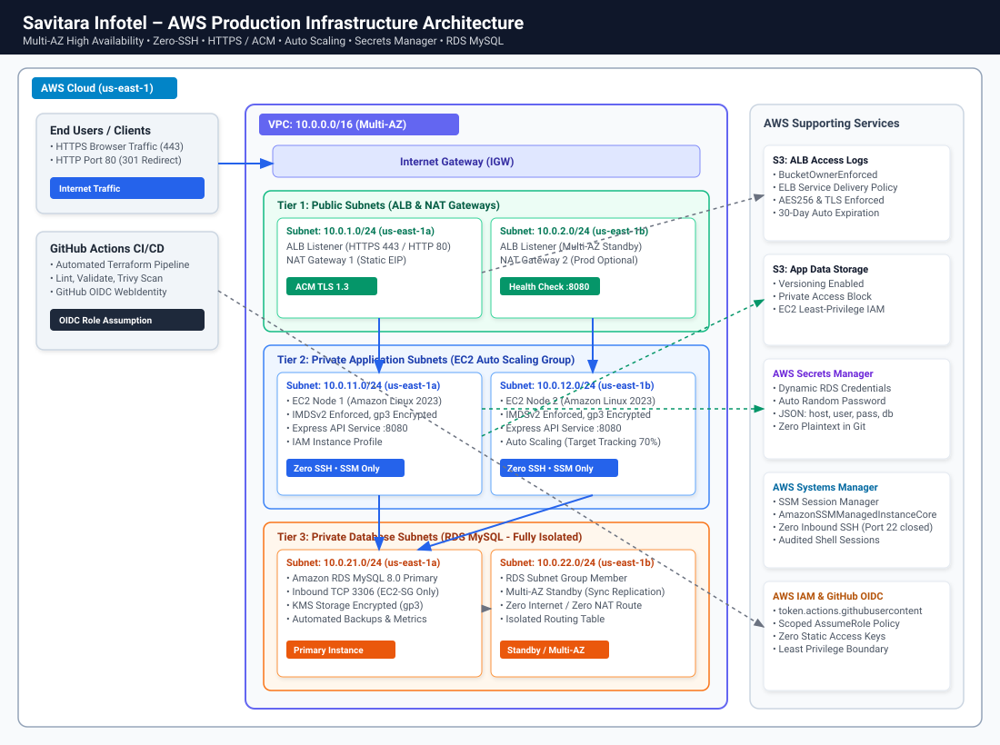
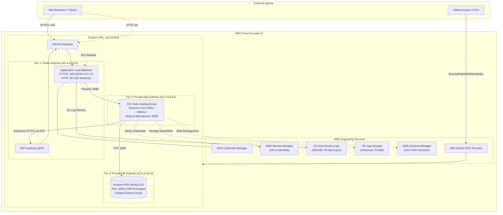

# DevOps Practical Task – AWS Infrastructure & CI/CD
### Savitara Infotel Practical Assignment Implementation

[](https://www.terraform.io/)
[](https://aws.amazon.com/architecture/well-architected/)
[](https://github.com/features/actions)
[](docs/SECURITY.md)

---

## 1. Project Overview & Scope Covered

This repository contains the complete, production-grade implementation of the **Savitara Infotel DevOps Practical Task**. The entire cloud footprint is provisioned using **Terraform (Infrastructure as Code)** to guarantee repeatability, consistency, and automated deployment, coupled with a **GitHub Actions CI/CD pipeline** authenticated via **AWS IAM OpenID Connect (OIDC)**.

### Architectural Flow:
$$\text{Internet} \xrightarrow{\text{HTTPS :443}} \text{Application Load Balancer} \xrightarrow{\text{HTTP :8080}} \text{Auto Scaling EC2 (Private)} \xrightarrow{\text{TCP :3306}} \text{RDS MySQL 8.0 (Private)}$$
$$\text{ALB} \xrightarrow{\text{Access Logs Delivery}} \text{S3 Bucket (Encrypted, Auto-Expiry)}$$

### Scope Covered:
- [x] **AWS Networking**: Custom VPC (`10.0.0.0/16`), Public Subnets, Private Application Subnets, and Private Database Subnets distributed across multiple Availability Zones (`us-east-1a`, `us-east-1b`), Internet Gateway, NAT Gateway with Elastic IP, and route table segregation.
- [x] **Compute & Auto Scaling**: EC2 Auto Scaling Group with Launch Template running Amazon Linux 2023, IMDSv2 strictly enforced, encrypted root EBS volume (gp3), automated cloud-init bootstrap, and target tracking CPU scaling policy.
- [x] **Application Load Balancer (ALB)**: Internet-facing ALB with HTTPS (Port 443) using ACM / TLS 1.3, automatic HTTP (Port 80) to HTTPS (Port 443) 301 redirection, and health checks on `/health`.
- [x] **Database Tier (RDS MySQL 8.0)**: MySQL 8.0 provisioned strictly in private database subnets with KMS storage encryption, custom parameter groups, and automated backups.
- [x] **AWS Secrets Manager**: Secure, dynamic generation and storage of database credentials in JSON format. Zero plaintext secrets in Git.
- [x] **IAM Roles & Least Privilege**: EC2 Instance Profile with least-privilege IAM policies, AWS Systems Manager (SSM) Session Manager for a **Zero-SSH** security policy, and GitHub Actions OIDC role.
- [x] **S3 Storage**: Dedicated S3 bucket for ALB Access Logs (with regional ELB Service Account bucket policy and 30-day lifecycle expiration) and S3 bucket for Application Storage.
- [x] **Application Source Code**: Lightweight, production-grade Node.js microservice with `/health`, `/`, `/db-check`, and `/info` (IMDSv2 inspection) endpoints.
- [x] **CI/CD Automation**: GitHub Actions workflow featuring Terraform format validation, Trivy security scanning, speculative plan commenting on PRs, and apply on merge to `main`.
- [x] **End-to-End Validation**: Python and Bash automated validation suites testing HTTP redirection, HTTPS availability, ASG health, and live RDS queries.

---

## 2. Architecture Diagram



### High-Level Service Interaction (Mermaid)



Detailed network and security specifications are documented in [docs/ARCHITECTURE.md](docs/ARCHITECTURE.md).

---

## 3. Repository Structure

```text
.
├── .github/
│   └── workflows/
│       ├── terraform.yml            # CI/CD: Lint, Validate, Trivy Scan, Plan on PR, Apply on main
│       └── app-ci.yml               # Node.js Application CI (Build, Unit Tests, Container)
├── app/                             # Application Source Code
│   ├── src/
│   │   ├── app.js                   # Express API (/health, /, /db-check, /info)
│   │   ├── db.js                    # MySQL connection pool & Secrets Manager client
│   │   └── server.js                # Server entrypoint with graceful shutdown
│   ├── test/
│   │   └── app.test.js              # Automated unit tests (Node.js native test runner)
│   ├── package.json                 # Dependencies & test scripts
│   ├── Dockerfile                   # Multi-stage production containerfile
│   └── README.md                    # Application service documentation
├── terraform/                       # Infrastructure as Code (Terraform)
│   ├── modules/
│   │   ├── vpc/                     # Custom VPC, 6 subnets across 2 AZs, IGW, NAT GW, Route Tables
│   │   ├── security_groups/         # Least-privilege rules (ALB-SG, EC2-SG, RDS-SG)
│   │   ├── alb/                     # Internet-facing ALB, HTTP 301 redirect, HTTPS 443, ACM cert
│   │   ├── asg/                     # Launch Template, IMDSv2, gp3, user_data bootstrap, ASG CPU policy
│   │   ├── rds/                     # RDS MySQL 8.0, Subnet Group, KMS encryption, parameter groups
│   │   ├── secrets/                 # Dynamic password generator & AWS Secrets Manager container
│   │   ├── iam/                     # EC2 Instance Profile, Least-Privilege Policies, GitHub OIDC Role
│   │   └── s3/                      # ALB Access Logs (ELB policy) & Application Storage buckets
│   ├── environments/
│   │   ├── dev/                     # Dev environment root module (Cost-optimized, single NAT GW)
│   │   └── prod/                    # Prod environment root module (Multi-AZ NAT, Multi-AZ RDS)
│   ├── bootstrap/                   # S3 Remote State Bucket + DynamoDB Lock Table provisioning
│   ├── main.tf                      # Top-level root module wiring all modules
│   ├── variables.tf                 # Top-level variables with production-ready defaults
│   ├── outputs.tf                   # Top-level outputs (Application URL, Health URL, RDS, etc.)
│   ├── providers.tf                 # AWS Provider configuration & default resource tags
│   ├── versions.tf                  # Required Terraform version (>= 1.5.0) & providers
│   ├── terraform.tfvars.example     # Example variable assignments
│   └── backend.tf.example           # S3 + DynamoDB state locking backend configuration
├── docs/                            # Documentation Suite
│   ├── ARCHITECTURE.md              # Detailed 3-tier architecture, CIDR table, network specs
│   ├── SECURITY.md                  # Security controls, IAM matrix, IMDSv2, zero-SSH via SSM
│   ├── DEPLOYMENT_GUIDE.md          # Step-by-step local CLI & CI/CD deployment guide
│   ├── CI_CD_PIPELINE.md            # GitHub Actions OIDC setup, secrets vs variables guide
│   ├── RUNBOOK.md                   # Operational runbook, SSM shell access, troubleshooting
│   ├── COST_OPTIMIZATION.md         # Financial analysis, AWS Free Tier breakdown, teardown
│   ├── diagrams/                    # SVG and Mermaid architecture diagrams
│   └── screenshots/                 # Submission screenshots guide and verification checklist
│       └── README.md
├── scripts/                         # Automation & Verification Scripts
│   ├── validate_deployment.py       # End-to-end Python health check & HTTP/HTTPS tester
│   ├── test_alb_health.sh           # Shell script for curl endpoint testing
│   └── setup_oidc_role.sh           # Helper script to configure GitHub OIDC IAM role via AWS CLI
└── README.md                        # Master project documentation
```

---

## 4. Application Source Code & Endpoints

A lightweight, robust Node.js microservice (`app/`) is deployed onto the private EC2 instances. It validates end-to-end connectivity from the public internet through the ALB and EC2 down to the private RDS MySQL database:

| Endpoint | Method | Response Description | Validated Flow |
|---|---|---|---|
| `/health` | `GET` | Returns HTTP `200 OK` with JSON uptime. Used by ALB Target Group. | ALB ➔ EC2 Health |
| `/` | `GET` | System dashboard showing environment, architecture summary, EC2 metadata, and DB status. | Internet ➔ HTTPS ALB ➔ EC2 ➔ RDS |
| `/db-check` | `GET` | Executes `SELECT NOW(), VERSION()` on RDS MySQL and returns query latency and database version. | EC2 ➔ Private RDS MySQL |
| `/info` | `GET` | Queries EC2 IMDSv2 to display instance ID, Availability Zone, and private IP. | EC2 IMDSv2 Token Security |

### Running Application Tests Locally:
```bash
cd app
npm install
npm test
```
All unit tests execute using Node's built-in test runner with zero external test framework overhead.

---

## 5. Deployment Instructions

### Prerequisites
- AWS CLI configured with administrator or deployment credentials: `aws configure`
- Terraform CLI installed (`>= 1.5.0`)
- Python 3 (`>= 3.9`)

### Quick Deployment (Local CLI)
```bash
# 1. Clone repository
git clone https://github.com/<your-username>/savitara-infotel-aws.git
cd savitara-infotel-aws/terraform

# 2. Configure variables
cp terraform.tfvars.example terraform.tfvars
# (Optional) Edit terraform.tfvars to adjust region or github_repo

# 3. Initialize Terraform
terraform init

# 4. Preview execution plan
terraform plan

# 5. Apply infrastructure (creates VPC, Subnets, ALB, ASG, RDS, Secrets Manager, S3, IAM)
terraform apply -auto-approve
```

Upon completion (~5–8 minutes), Terraform outputs the public endpoints:
```text
Outputs:
alb_dns_name                = "savitara-dev-alb-123456789.us-east-1.elb.amazonaws.com"
application_url             = "https://savitara-dev-alb-123456789.us-east-1.elb.amazonaws.com"
health_check_url            = "https://savitara-dev-alb-123456789.us-east-1.elb.amazonaws.com/health"
rds_endpoint                = "savitara-dev-mysql.xxxxxx.us-east-1.rds.amazonaws.com:3306"
secrets_manager_secret_name = "savitara-dev-db-credentials-xxxx"
autoscaling_group_name      = "savitara-dev-asg-xxxx"
```

For comprehensive step-by-step instructions (including remote state bootstrapping), see [docs/DEPLOYMENT_GUIDE.md](docs/DEPLOYMENT_GUIDE.md).

---

## 6. GitHub Actions CI/CD & OIDC Configuration

The CI/CD pipeline (`.github/workflows/terraform.yml`) uses **GitHub OIDC** with AWS STS `AssumeRoleWithWebIdentity`, eliminating long-lived AWS static credentials (`AWS_ACCESS_KEY_ID` / `AWS_SECRET_ACCESS_KEY`).

### GitHub Configuration Matrix

#### Repository Secrets (`Settings > Secrets and variables > Actions > Secrets`)
| Name | Required | Description |
|---|---|---|
| `AWS_ROLE_ARN` | **Yes** | ARN of the IAM role configured for GitHub OIDC (output by `module.iam.github_actions_role_arn` or `./scripts/setup_oidc_role.sh`). |

#### Repository Variables (`Settings > Secrets and variables > Actions > Variables`)
| Name | Required | Description |
|---|---|---|
| `AWS_REGION` | **Yes** | AWS Region (e.g., `us-east-1`). |
| `TF_STATE_BUCKET` | Optional | S3 bucket name for Terraform remote state backend. |
| `TF_STATE_DYNAMODB_TABLE` | Optional | DynamoDB table name for Terraform state locking. |
| `ACM_CERTIFICATE_ARN` | Optional | Custom ACM Certificate ARN if binding an existing public domain. |

> [!IMPORTANT]
> **What is NOT stored as a secret in GitHub**:
> - `AWS_ACCESS_KEY_ID` & `AWS_SECRET_ACCESS_KEY`: Replaced by dynamic OIDC STS temporary tokens.
> - Database password: Dynamically generated by Terraform and stored directly in AWS Secrets Manager.

Full CI/CD setup details are documented in [docs/CI_CD_PIPELINE.md](docs/CI_CD_PIPELINE.md).

---

## 7. End-to-End Validation & Verification

After provisioning, allow 2–3 minutes for the EC2 instances to finish user data installation and register as `healthy` in the ALB Target Group.

Run the automated verification suite:
```bash
python scripts/validate_deployment.py <ALB_DNS_NAME>
```

### Verification Checklist:
- [x] **HTTP to HTTPS 301 Redirect**: Queries `http://<ALB_DNS_NAME>/health` and asserts HTTP 301 response with `Location: https://...`.
- [x] **HTTPS Health Check**: Queries `https://<ALB_DNS_NAME>/health` and asserts HTTP 200 with `status: "healthy"`.
- [x] **Architecture Dashboard**: Queries `https://<ALB_DNS_NAME>/` and verifies operational status and runtime metadata.
- [x] **RDS Database Query**: Queries `https://<ALB_DNS_NAME>/db-check` and verifies that the EC2 application successfully queries MySQL `SELECT NOW(), VERSION()` via private subnets.
- [x] **IMDSv2 Verification**: Queries `https://<ALB_DNS_NAME>/info` and validates that EC2 instance ID and Availability Zone are retrieved via secure IMDSv2 token headers.

---

## 8. Senior DevOps Engineer Review & Design Decisions

### 1. Network Isolation & Routing Table Strategy
- **Design**: The database tier has an isolated route table with **no route to the Internet Gateway and no route to the NAT Gateway**.
- **Rationale**: Defense-in-depth. Even in the event of an application-tier compromise or container breakout, the database cannot initiate outbound command-and-control traffic or exfiltrate data to the internet.

### 2. Zero-SSH Administration via AWS Systems Manager
- **Design**: Inbound TCP port 22 is completely omitted from all security groups. Administration is performed via AWS SSM Session Manager (`AmazonSSMManagedInstanceCore`).
- **Rationale**: Eliminates the need for bastion jump hosts, eliminates static SSH private keys, and produces an immutable audit log of all administrative shell sessions in AWS CloudTrail and CloudWatch Logs.

### 3. IMDSv2 Strict Enforcement
- **Design**: `http_tokens = "required"` and `http_put_response_hop_limit = 1`.
- **Rationale**: Mitigates Server-Side Request Forgery (SSRF) vulnerabilities from extracting IAM instance profile credentials.

### 4. Dynamic Secrets Handling
- **Design**: Database passwords are generated via Terraform `random_password`, injected into AWS Secrets Manager, and ingested by EC2 instances using scoped IAM permissions.
- **Rationale**: Zero plaintext credentials stored in version control, and passwords can be rotated independently without rebuilding the EC2 Launch Template.

### 5. Cost-Conscious Architecture
- **Design**: Uses a single NAT Gateway in development (`single_nat_gateway = true`), `t3.micro` burstable instances, and 30-day S3 log lifecycle expiration.
- **Rationale**: Saves ~\$32/month per additional AZ in development while providing a one-line toggle (`single_nat_gateway = false` in `terraform/environments/prod`) for production multi-AZ NAT resilience.

---

## 9. Identification of External Prerequisites & Manual Steps

In accordance with professional DevOps assessment guidelines, the following items require external environment configuration:

| Component | Status | Required Manual Step |
|---|---|---|
| **AWS Account Access** | Pending User AWS Execution | Run `aws configure` with credentials possessing IAM, VPC, EC2, RDS, S3, and ALB provisioning permissions. |
| **Custom Public Domain / DNS** | Self-Contained Fallback Provided | If you own a public domain in Route 53, provide `acm_certificate_arn` in `terraform.tfvars`. If not provided, the module **automatically generates and imports a valid self-signed certificate into ACM**, ensuring Terraform deploys the HTTPS 443 listener without failing or blocking! |
| **GitHub Repository Permissions** | Configuration Required | Add `AWS_ROLE_ARN` to your GitHub Repository Secrets after deploying the IAM OIDC module. |

---

## 10. Teardown & Cleanup

To eliminate all cloud resources after assessment evaluation:

```bash
cd terraform
terraform destroy -auto-approve
```

If the remote state bootstrap module was provisioned:
```bash
cd terraform/bootstrap
terraform destroy -auto-approve
```
All billable resources are deleted cleanly within 5–8 minutes.

---

## 11. Submission Deliverables Summary

- [x] **GitHub Repository Layout**: Standard root module, environment overlays (`dev`, `prod`), modular reusable components (`modules/`).
- [x] **Application Source Code**: Node.js microservice (`app/`) with automated tests passing.
- [x] **Terraform IaC**: 100% syntactically and structurally validated (`terraform validate` passed on root, dev, prod, and bootstrap).
- [x] **GitHub Actions Workflow**: Complete CI/CD with OIDC authentication, linting, Trivy scan, speculative planning, and apply.
- [x] **Architecture Diagrams**: [docs/diagrams/architecture_diagram.svg](docs/diagrams/architecture_diagram.svg) and Mermaid diagram.
- [x] **Screenshots Guide**: [docs/screenshots/README.md](docs/screenshots/README.md) with CLI commands and console paths.
- [x] **Technical Documentation**: [docs/ARCHITECTURE.md](docs/ARCHITECTURE.md), [docs/SECURITY.md](docs/SECURITY.md), [docs/DEPLOYMENT_GUIDE.md](docs/DEPLOYMENT_GUIDE.md), [docs/CI_CD_PIPELINE.md](docs/CI_CD_PIPELINE.md), [docs/RUNBOOK.md](docs/RUNBOOK.md), [docs/COST_OPTIMIZATION.md](docs/COST_OPTIMIZATION.md).
